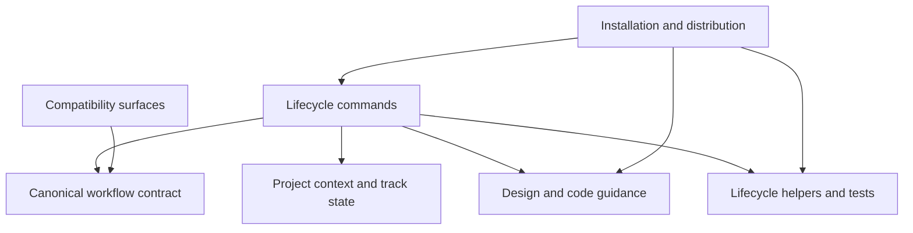

# Architecture Overview

Conductor is an OpenCode-oriented, spec-driven workflow toolkit. Canonical
doctrine defines lifecycle invariants; command instructions adapt them to the
host; project-local records carry approved context and track state; scripts
support bounded lifecycle operations and regression checks.

## Read in this order

1. [Lifecycle commands](./components/lifecycle-commands.md)
2. [Canonical workflow contract](./components/workflow-contract.md)
3. [Project context and track state](./components/project-state.md)
4. [Design and code guidance](./components/guidance-assets.md)
5. [Installation and distribution](./components/installation.md)
6. [Lifecycle helpers and tests](./components/helpers-and-tests.md)
7. [Compatibility surfaces](./components/compatibility.md)

## Component flow

